# UrbanDrive – Final Project Documentation

DBMS Level 3 Project · Car Rental and Fleet Management System
Team: aarush-170, Abhay DB (abhaydb12)

This document completes the submission. Problem statement, ER model, relational schema, database choice and the four key queries are written up in [`phase1_report.md`](phase1_report.md); this report adds objectives and scope, the data dictionary, the NoSQL design, architecture, authentication and security, test results and screenshots.

Contents: 1 Objectives and scope · 2 Functional requirements · 3 Database choice (summary) · 4 Data dictionary · 5 MongoDB design · 6 SQL implementation · 7 Important queries · 8 Architecture · 9 Authentication, authorization and security · 10 Test cases and results · 11 Screenshots · 12 Conclusion and future work

---

## 1. Objectives and scope

**Problem.** Multi-branch rental agencies lose money and customer trust through double bookings, untracked servicing and hand-calculated late fees (full statement in phase 1 report, section 1).

**Objectives**
1. Prevent double bookings and bookings with an expired licence inside the database, not only in the UI.
2. Automate the rental lifecycle: create → start → return (late fee, balance) → cancel (refund).
3. Give each role only the screens and actions it needs (admin, branch manager, customer).
4. Report revenue by category and quarter, vehicles overdue for service, and customer history with penalties.
5. Keep semi-structured inspection and review data in a document store and analyse it with aggregation pipelines.

**In scope:** customers, vehicles, categories, branches, bookings, payments, maintenance, login with roles, inspections and reviews, reports. **Out of scope:** payment-gateway integration, GPS tracking, mobile app, self-service account registration (accounts are created by an administrator).

## 2. Functional requirements

| ID | Requirement | Roles |
|---|---|---|
| F1 | Sign in and out; session expires after 8 hours | all |
| F2 | Browse and search the fleet (full-text on make/model, filter by branch, category, status) | all |
| F3 | Search vehicles free for a date range | all |
| F4 | Create a booking (30% advance payment taken in the same transaction) | customer (for self), staff (for any customer) |
| F5 | Start rental, return vehicle (late fee and balance computed), cancel booking | staff; customer may cancel own booking |
| F6 | View booking list and status filters | staff: all, customer: own only |
| F7 | Customer register, search, booking history with late penalties | staff; customer sees own history |
| F8 | Add vehicle; send to workshop / reinstate / decommission | add: admin; status: staff |
| F9 | Log and list maintenance, list vehicles over 10,000 miles since last service | staff; delete record: admin |
| F10 | Revenue by category per quarter, branch availability | admin |
| F11 | Record vehicle inspections (damage, fuel/battery) | staff |
| F12 | Review a completed booking; aggregated rating, damage and tag insights, review text search | review: customer for own booking; insights: admin |

## 3. Database choice (summary)

| Data | Store | Why |
|---|---|---|
| Customers, vehicles, branches, bookings, payments, maintenance, accounts | **MySQL 8** | Strongly related records, money and availability must be consistent: foreign keys, CHECK constraints, triggers and ACID transactions |
| Vehicle inspections and customer reviews | **MongoDB** | Each inspection has a different shape (variable damage list, fuel level for petrol cars but battery percent for EVs, optional photos); reviews carry free text and tags. Documents avoid sparse columns and join tables, and aggregation pipelines suit the analytics |

Full justification: phase 1 report, section 4.

## 4. Data dictionary (MySQL, database `mini_project`)

`PK` primary key · `FK` foreign key · `UQ` unique · `NN` not null. All tables are InnoDB.

### Branch
| Column | Type | Constraints |
|---|---|---|
| branch_id | INT | PK, auto increment |
| branch_name | VARCHAR(100) | NN |
| city | VARCHAR(50) | NN |
| address | VARCHAR(255) | NN |
| contact_number | VARCHAR(15) | NN, CHECK `^[0-9+]{7,15}$` |
| capacity | INT | CHECK > 0 |

### Customer
| Column | Type | Constraints |
|---|---|---|
| customer_id | INT | PK |
| first_name, last_name | VARCHAR(50) | NN |
| email | VARCHAR(100) | NN, UQ, CHECK email pattern |
| phone | VARCHAR(15) | NN, CHECK 7-15 digits |
| license_number | VARCHAR(30) | NN, UQ |
| license_expiry_date | DATE | NN |

### Vehicle_Category
| Column | Type | Constraints |
|---|---|---|
| category_id | INT | PK |
| category_name | VARCHAR(50) | NN, UQ |
| base_rate_per_day | DECIMAL(10,2) | NN, CHECK > 0 |
| late_fee_per_hour | DECIMAL(10,2) | NN, CHECK >= 0 |
| security_deposit | DECIMAL(10,2) | NN, CHECK >= 0 |

### Vehicle
| Column | Type | Constraints |
|---|---|---|
| vehicle_id | INT | PK |
| vin | VARCHAR(17) | NN, UQ, CHECK length = 17 |
| license_plate | VARCHAR(15) | NN, UQ |
| make, model | VARCHAR(50) | NN, FULLTEXT index |
| manufacture_year | INT | CHECK >= 2000 |
| current_mileage | INT | NN, default 0, CHECK >= 0 |
| status | VARCHAR(20) | NN, CHECK in Available / Rented / In_Maintenance / Decommissioned |
| category_id | INT | FK → Vehicle_Category |
| current_branch_id | INT | FK → Branch |

### Rental_Booking
| Column | Type | Constraints |
|---|---|---|
| booking_id | INT | PK |
| customer_id | INT | FK → Customer (ON DELETE CASCADE) |
| vehicle_id | INT | FK → Vehicle |
| pickup_branch_id, dropoff_branch_id | INT | FK → Branch |
| start_date, end_date | DATETIME | NN, CHECK end > start |
| actual_return_date | DATETIME | NULL until returned |
| initial_mileage, return_mileage | INT | CHECK return >= initial |
| booking_status | VARCHAR(20) | CHECK in Confirmed / Ongoing / Completed / Cancelled |
| late_fee, total_amount | DECIMAL(10,2) | CHECK >= 0 |

### Payment
| Column | Type | Constraints |
|---|---|---|
| payment_id | INT | PK |
| booking_id | INT | FK → Rental_Booking (ON DELETE CASCADE) |
| payment_date | DATETIME | NN |
| payment_method | VARCHAR(30) | CHECK in Credit Card / Debit Card / UPI / Net Banking / Cash |
| amount_paid | DECIMAL(10,2) | CHECK > 0 |
| payment_status | VARCHAR(20) | CHECK in Pending / Success / Refunded / Failed |

### Maintenance_Record
| Column | Type | Constraints |
|---|---|---|
| maintenance_id | INT | PK |
| vehicle_id | INT | FK → Vehicle (ON DELETE CASCADE) |
| service_date | DATE | NN |
| service_type | VARCHAR(100) | NN |
| mileage_at_service | INT | CHECK >= 0, trigger: not above vehicle mileage |
| cost | DECIMAL(10,2) | CHECK >= 0 |
| notes | TEXT | |

### User_Account
| Column | Type | Constraints |
|---|---|---|
| user_id | INT | PK |
| username | VARCHAR(50) | NN, UQ |
| email | VARCHAR(100) | NN, UQ |
| password_hash | VARCHAR(100) | NN, **bcrypt hash** (never plain text) |
| role | VARCHAR(20) | CHECK in Admin / Branch_Manager / Customer |
| customer_id | INT | FK → Customer, UQ; required when role = Customer |
| branch_id | INT | FK → Branch; required when role = Branch_Manager |
| created_at | TIMESTAMP | default now |

A table-level CHECK (`chk_user_link`) ties each role to the right link column, so a customer account cannot exist without a customer record.

## 5. MongoDB design (database `urbandrive`)

### Collections and documents

`vehicle_inspections` – one document per pickup or return inspection (example shape):

```json
{
  "booking_id": 9, "vehicle_id": 6, "type": "return",
  "inspected_at": "2026-09-04T09:00:00Z", "odometer": 8120,
  "fuel_level": "3/4",            // petrol cars
  "battery_percent": 62,          // electric cars (field absent otherwise)
  "damages": [ { "part": "rear bumper", "severity": "minor", "note": "scratch", "estimated_cost": 0 } ],
  "photos": []
}
```

`vehicle_reviews` – one document per completed booking (one review per booking is enforced by the API):

```json
{ "booking_id": 9, "vehicle_id": 6, "customer_id": 1, "category_id": 8,
  "rating": 4, "comment": "Smooth ride, great range", "tags": ["electric", "city"], "created_at": "..." }
```

The documents reference MySQL rows by id (`booking_id`, `vehicle_id`, `customer_id`, `category_id`); MySQL stays the source of truth for who rented what, and the API checks the booking in MySQL before writing a document.

### Indexes
| Collection | Index | Used for |
|---|---|---|
| vehicle_inspections | `{vehicle_id: 1, inspected_at: -1}` | inspection list on a vehicle page |
| vehicle_inspections | `{booking_id: 1, type: 1}` | find the pickup/return pair of a booking |
| vehicle_inspections | `{"damages.severity": 1}` | damage analytics |
| vehicle_reviews | `{vehicle_id: 1, created_at: -1}` | review list on a vehicle page |
| vehicle_reviews | `{category_id: 1, rating: -1}` | rating by category |
| vehicle_reviews | text index on `comment` and `tags` | review search |

### Retrieval and aggregation (requirement: one NoSQL feature)
All pipelines are in `web/lib/insights.ts` and shown on the Insights page:
- **Average rating by category**: `$group` on `category_id` with `$avg`, names joined from MySQL.
- **Damage by severity**: `$unwind: "$damages"` then `$group` with `$sum` of incidents and estimated cost.
- **Most damaged vehicles**: `$unwind`, `$group` by vehicle, `$sort`, `$limit 5`.
- **Popular tags**: `$unwind: "$tags"`, `$group`, `$sort`, `$limit`.
- **Review search**: `$text` query ranked by `{$meta: "textScore"}`.

No vector search is used: the data is small and structured enough that a keyword text index answers the questions, so a vector store would add technology without a need (the brief asks for justified choices).

## 6. SQL implementation

| File | Contents |
|---|---|
| `database/01_schema.sql` | CREATE DATABASE, DROP/CREATE tables, PK/FK, UNIQUE, CHECK, indexes, FULLTEXT |
| `database/02_seed.sql` | Sample data, 10–30 rows per table |
| `database/03_advanced.sql` | 4 views, function `fn_late_fee`, 3 triggers, 4 stored procedures with transactions |
| `database/04_alter_examples.sql` | ALTER TABLE add/modify/drop column, constraint and index, plus CREATE/DROP TABLE; reverts itself so it can be re-run |

DML in the application: INSERT (customers, vehicles, maintenance, bookings, payments via procedure), UPDATE (vehicle status, booking lifecycle via procedures and triggers), DELETE (maintenance records, admin only), SELECT with JOIN, GROUP BY, HAVING, ORDER BY, aggregates and subqueries (`web/lib/queries.ts`).

Advanced features (4 required, 7 present) are listed in phase 1 report section 5.4: transactions with row locking, triggers, views, stored function, indexing, full-text search and MongoDB aggregation.

Data validation and integrity at database level: CHECK constraints on every table, UNIQUE keys, foreign keys (RESTRICT by default, CASCADE where children are meaningless without the parent), triggers for rules a CHECK cannot express (overlapping bookings, expired licence, decommissioned vehicle, service mileage), and transactions so booking + payment either both happen or neither does.

## 7. Important queries

The four key queries (availability by date range, revenue per category per quarter, vehicles over 10,000 miles since last service, customer history with late penalties) are written out with SQL in phase 1 report section 5.3 and are served by the views in `03_advanced.sql`. Each has a screen: Vehicles (availability search), Reports (revenue, maintenance due, branch availability), Maintenance, Customer detail.

## 8. Architecture

```
 Browser ──HTTPS/HTTP──▶  Next.js 16 app (web/)
                          ├─ proxy.ts            checks the signed session cookie, redirects or returns 401
                          ├─ app/*  pages        server components: re-check role, read data, render
                          ├─ app/api/*           Route Handlers: requireApi(role) → zod validation → SQL / Mongo
                          └─ lib/                db.ts (mysql2 pool) · mongo.ts · auth.ts · queries.ts · insights.ts
                                   │                         │
                                   ▼                         ▼
                           MySQL 8 (mini_project)    MongoDB (urbandrive)
                           tables, views, triggers,  vehicle_inspections,
                           procedures, accounts      vehicle_reviews
```

Configuration comes from environment variables (`web/.env.local`, template `web/.env.example`): MySQL host/user/password/database, MongoDB URI/database, `AUTH_SECRET`. Nothing secret is in the source code, and `.env*` files are git-ignored.

## 9. Authentication, authorization and security

**Login.** `POST /api/auth/login` looks the user up in `User_Account`, compares the password against the stored **bcrypt** hash, and on success sets an `HttpOnly`, `SameSite=Lax` cookie holding a JWT signed (HS256) with `AUTH_SECRET`, valid for 8 hours. A wrong username and a wrong password give the same error and take similar time. Passwords are never stored or logged in plain text.

**Roles (3, minimum 2 required)**

| Area | Admin | Branch manager | Customer |
|---|---|---|---|
| Dashboard | yes | yes | – (sent to Vehicles) |
| Vehicles: browse, search, availability | yes | yes | yes |
| Vehicles: add | yes | – | – |
| Vehicles: workshop / decommission / reinstate | yes | yes | – |
| Bookings: list | all | all | own only |
| Bookings: create | for any customer | for any customer | for self only (server overrides `customer_id`) |
| Bookings: start, return | yes | yes | – |
| Bookings: cancel | yes | yes | own only |
| Customers: list, register | yes | yes | – (own profile only) |
| Maintenance: view, log | yes | yes | – |
| Maintenance: delete | yes | – | – |
| Reports (revenue, availability) | yes | – | – |
| Insights (MongoDB analytics) | yes | – | – |
| Inspections: record | yes | yes | – |
| Reviews: add | yes | – | own completed bookings |

**Defence in depth.** Three layers enforce this: `proxy.ts` (fast redirect/401 on every request), each page (`requirePage`) and each Route Handler (`requireApi`). The UI hides what a role cannot use, but the server checks again, so hand-crafted requests are refused (tests TC04–TC10, TC14).

**Other practices.** Parameterised SQL only (no string-built queries); zod validation on every request body; database errors are mapped to safe messages (no SQL or stack traces reach the browser); CHECK constraints repeat the validation inside MySQL.

**Seeded demo accounts** (all use the development password shown in the seed header, stored only as bcrypt hashes):

| Username | Role | Linked to |
|---|---|---|
| admin | Admin | – |
| mgr_downtown, mgr_mumbai | Branch_Manager | branch 1, branch 4 |
| cust_rohan, cust_ananya, … cust_meera | Customer | customers 1 to 8 |

Change these passwords before any real deployment.

## 10. Test cases and results

Automated suite: `web/tests/api.test.mjs` (Node's built-in test runner; start the app, then `npm test` in `web/`). Result of the last run: **18 passed, 0 failed**. Each run leaves one *Cancelled* test booking in the database (a customer cannot delete bookings); remove it with `DELETE FROM Rental_Booking WHERE booking_id > 20;` if a clean seed is wanted.

| ID | Test | Expected | Result |
|---|---|---|---|
| TC01 | Login with valid credentials | 200, role returned | Pass |
| TC02 | Wrong password / unknown user | 401, identical message | Pass |
| TC03 | Session cookie flags; no hash in response | HttpOnly; no `$2` hash | Pass |
| TC04 | API without session / page without session | 401 / redirect to login | Pass |
| TC05 | Forged session cookie | 401 | Pass |
| TC06 | Customer calls staff/admin APIs | 403, report page redirects | Pass |
| TC07 | Manager: customers/maintenance ok, revenue and maintenance delete refused | 200 / 403 | Pass |
| TC08 | Admin revenue report (view + GROUP BY) | 200, rows | Pass |
| TC09 | Customer sees only own bookings | subset of admin list | Pass |
| TC10 | Manager adds vehicle; customer changes status | 403 | Pass |
| TC11 | Bad phone number, short VIN | 400 | Pass |
| TC12 | Maintenance mileage above vehicle mileage (trigger) | 409 | Pass |
| TC13 | Booking in a transaction, advance payment recorded, overlapping booking refused (trigger), customer cannot start rental, customer cancels | 201 / 409 / 403 / 200 | Pass |
| TC13b | Booking that starts in the past | 400 | Pass |
| TC14 | Customer cancels another customer's booking | 403 | Pass |
| TC15 | Availability search; end before start | 200 / 400 | Pass |
| TC16 | Review for a booking that is not a completed booking of the vehicle | 400 | Pass |
| TC17 | Logout clears cookie | cookie removed | Pass |

Direct SQL checks (run in MySQL):

| Statement | Result |
|---|---|
| INSERT vehicle with a 8-character VIN | Error 3819, `chk_vehicle_vin` violated |
| INSERT customer with email `not-an-email` | Error 3819, `chk_customer_email` violated |
| DELETE a branch that has bookings | Error 1451, foreign key `fk_booking_dropoff` |
| INSERT maintenance with mileage 99,999,999 | Error 1644, "Mileage at service exceeds the vehicle current mileage" |
| `04_alter_examples.sql` | runs cleanly, schema identical afterwards |
| Phase 1 checks (overlap, licence, decommissioned, late fee, refund, duplicate email) | see phase 1 report section 5.5 |

## 11. Screenshots

| | |
|---|---|
| Login | 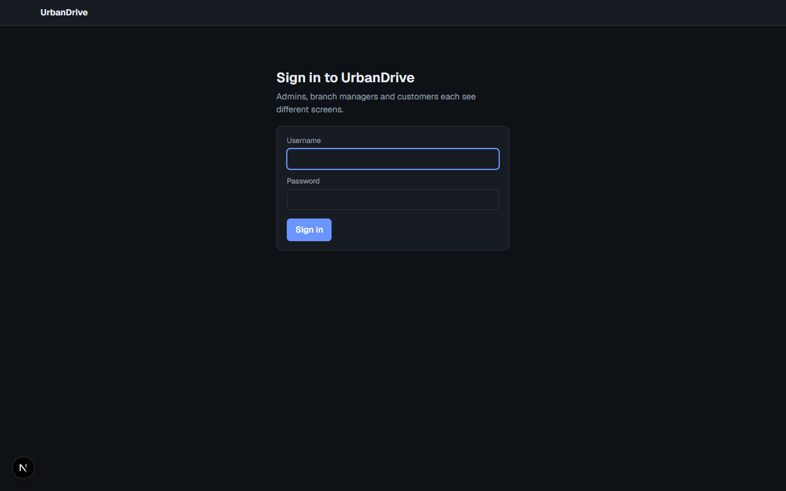 |
| Admin dashboard | 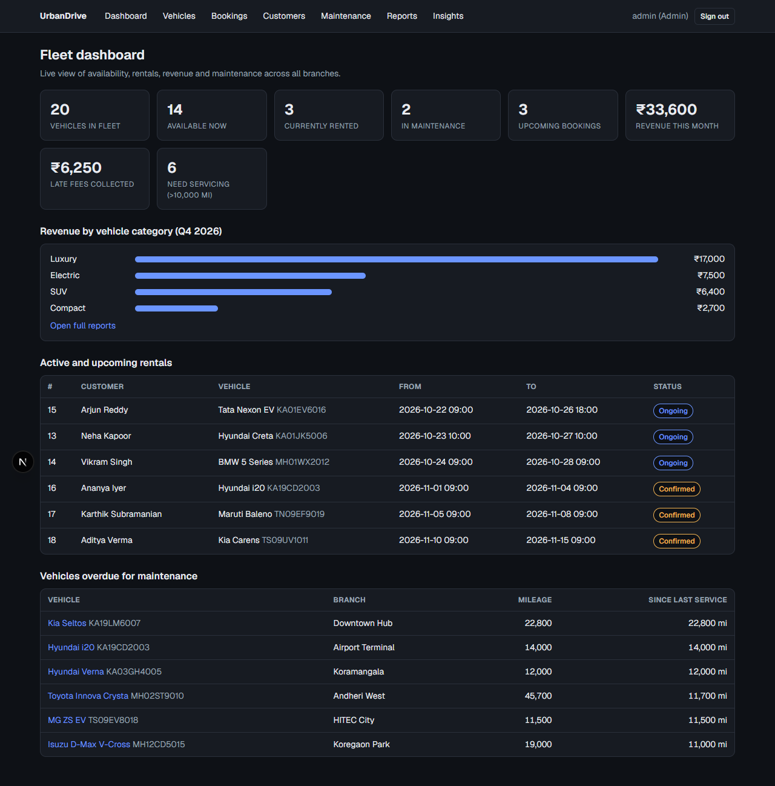 |
| Fleet list with search and filters | 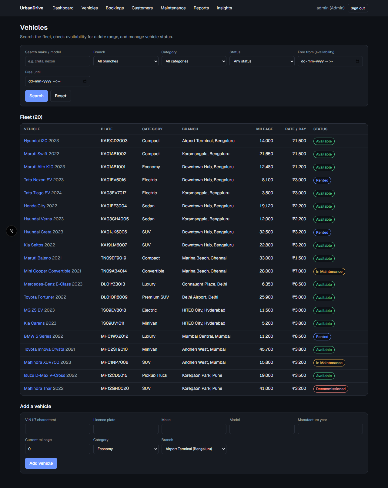 |
| Availability for a date range | 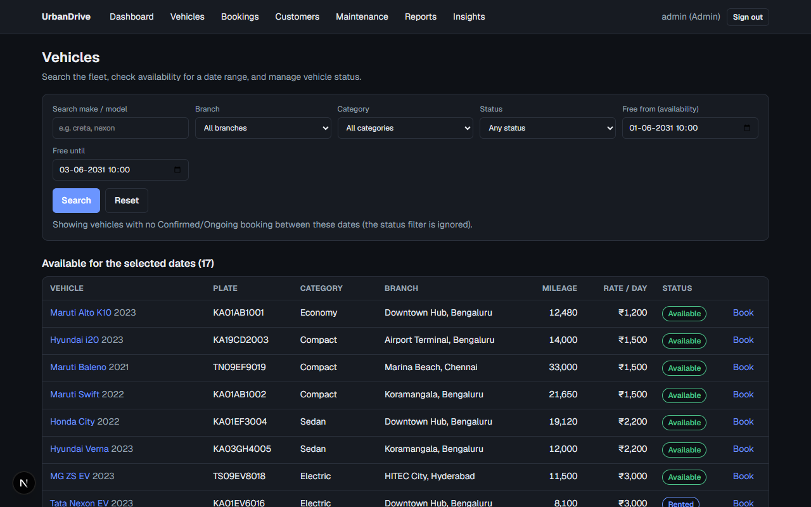 |
| Vehicle detail with MongoDB inspections and reviews | 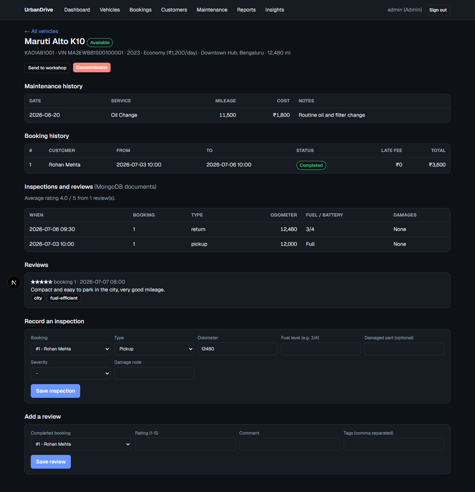 |
| Bookings with lifecycle actions | 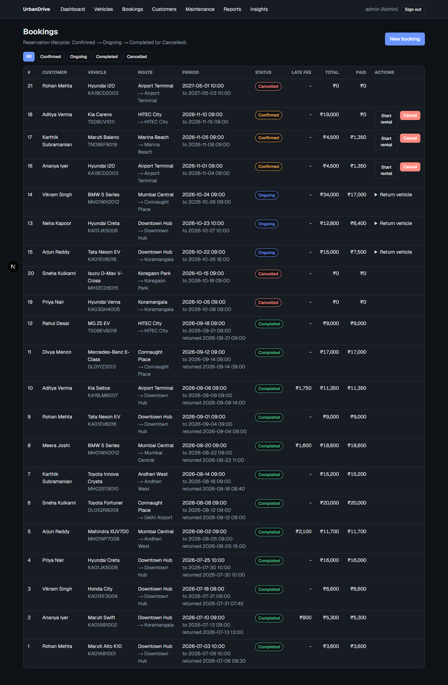 |
| New booking (stored procedure) | 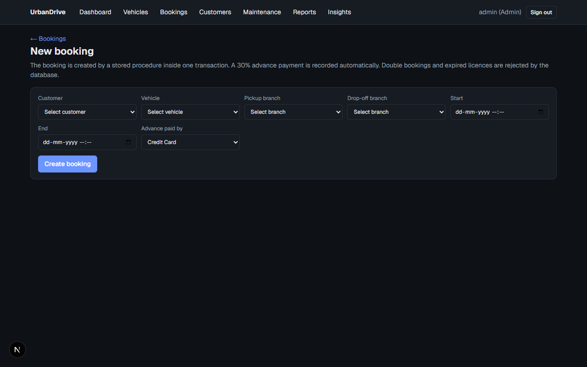 |
| Customer history with late fees | 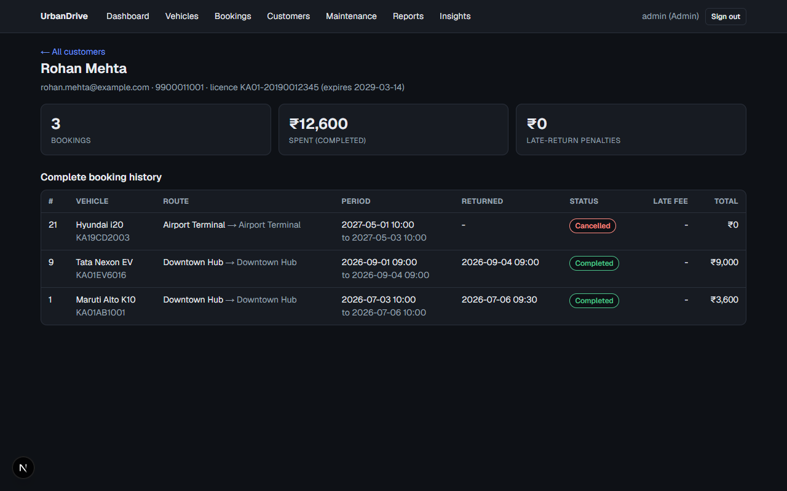 |
| Maintenance | 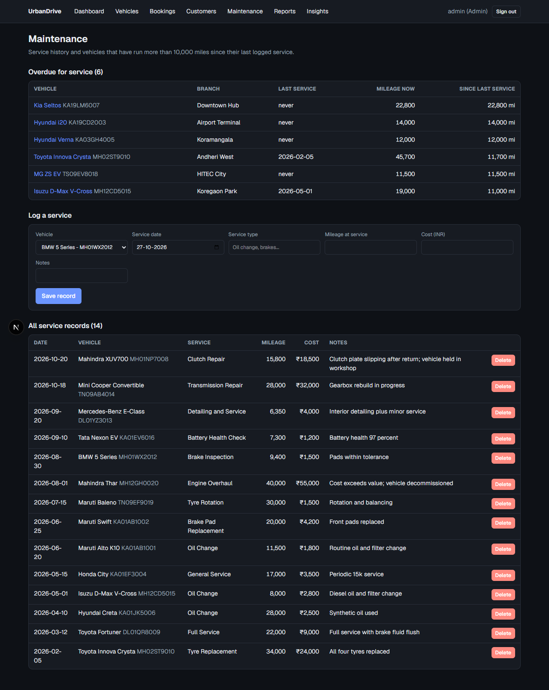 |
| Reports | 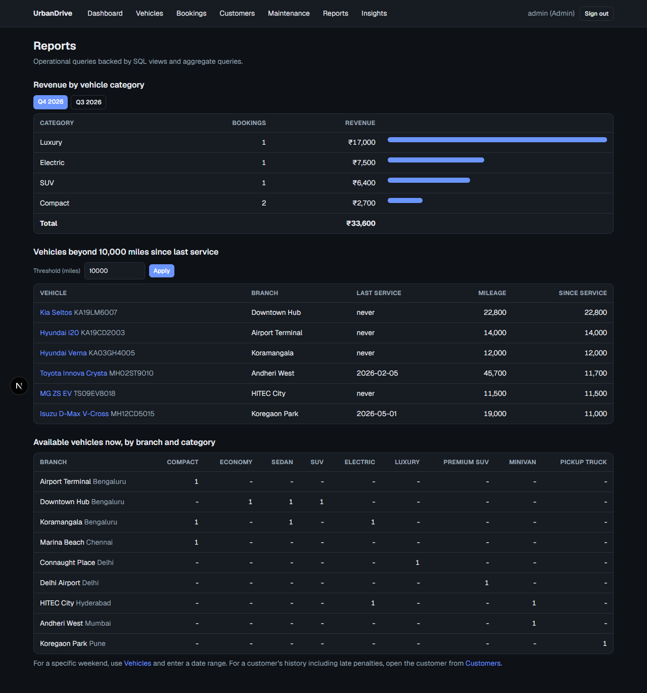 |
| Insights (MongoDB aggregations) | 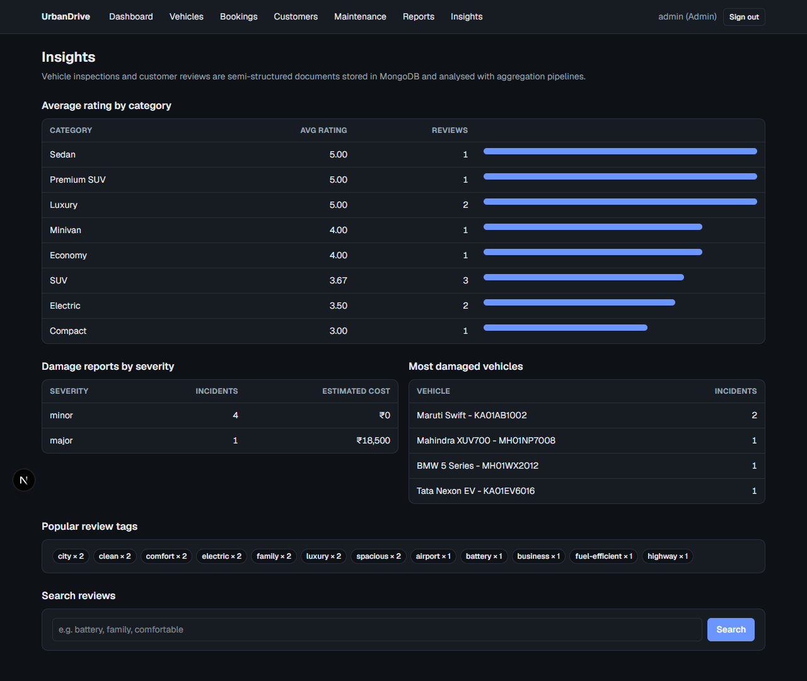 |
| Branch manager view | 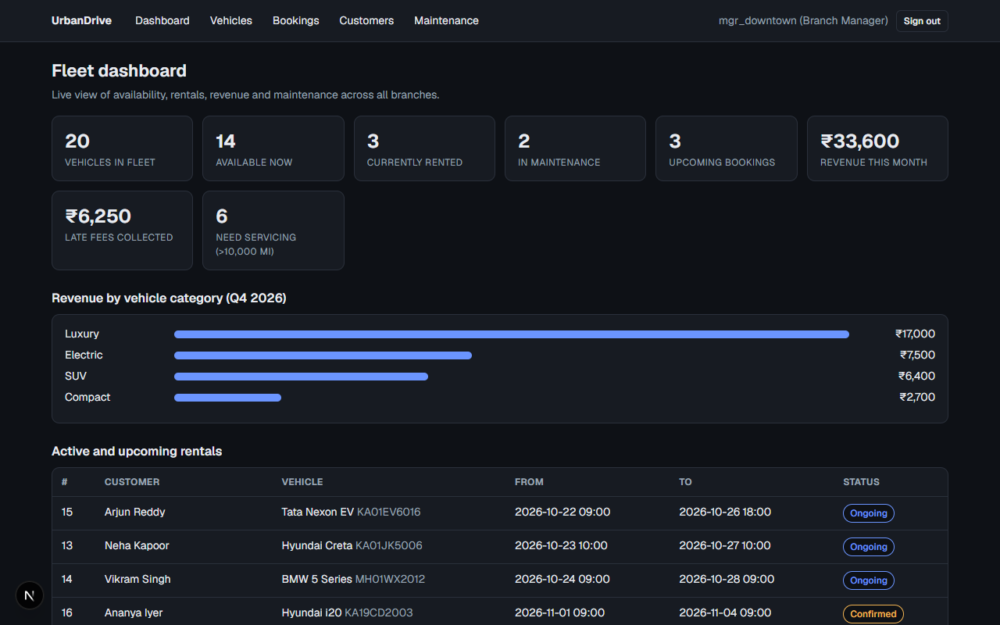 |
| Customer view: vehicles | 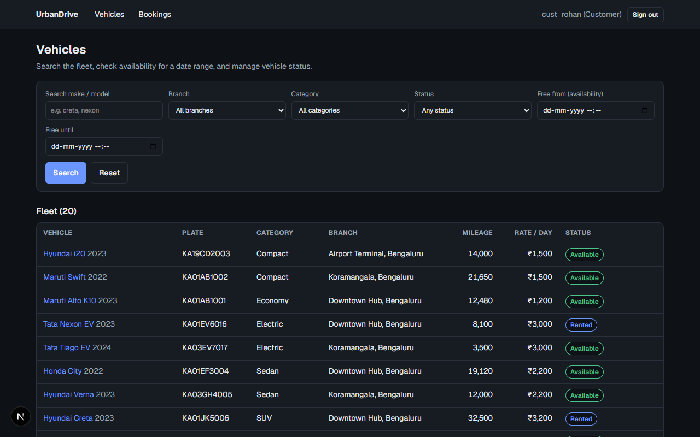 |
| Customer view: own bookings only | 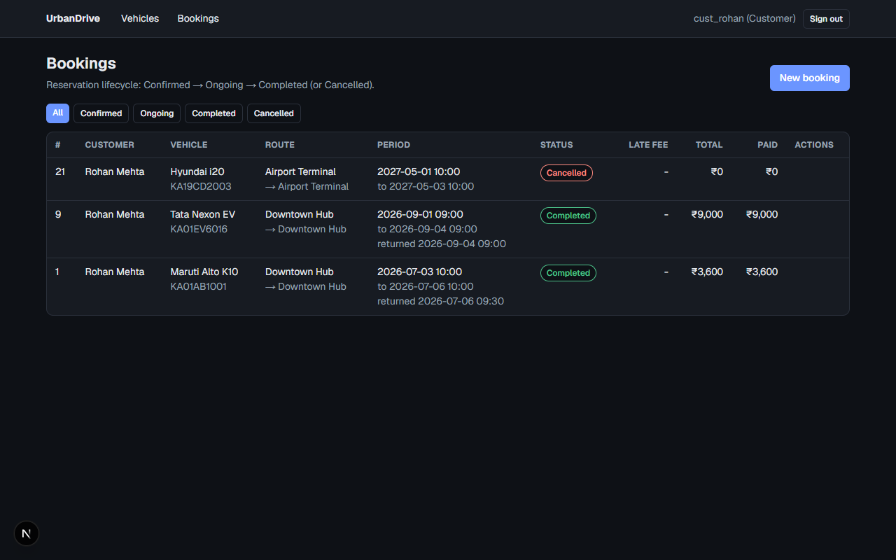 |

## 12. Conclusion and future enhancements

UrbanDrive combines a relational core (MySQL) that keeps rentals and money consistent with a document store (MongoDB) for variable inspection and review data, behind a role-based Next.js application. The database enforces the business rules itself, so the rules hold no matter which client writes the data.

Possible next steps: an admin screen to create and disable user accounts and reset passwords; password change for customers; rate limiting on login; payment-gateway integration; photo upload for inspections (the `photos` array is already in the model); embeddings of review text for semantic search if the review volume grows; automated database backups.
