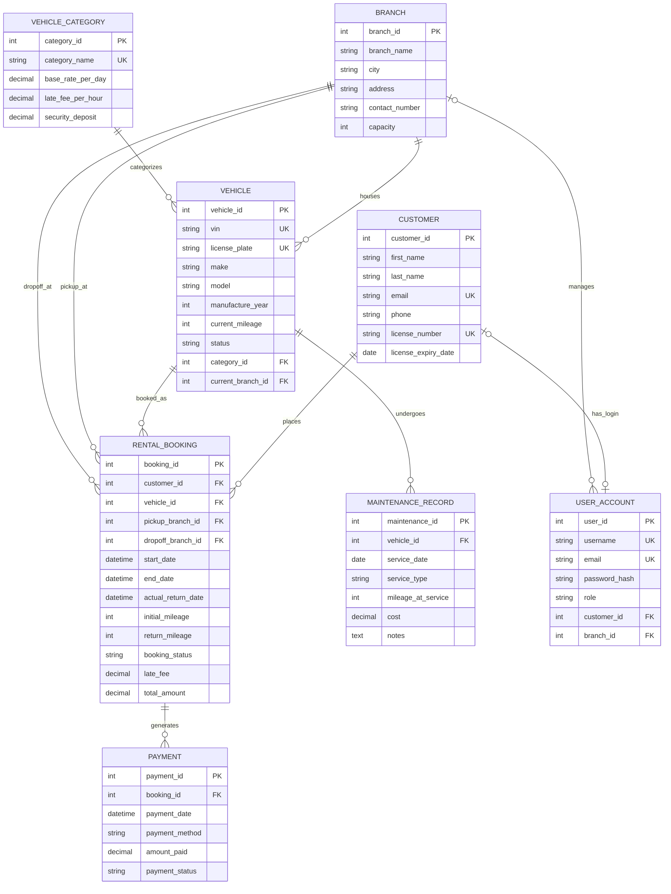

# UrbanDrive – Phase 1 Report

DBMS Level 3 Project · Car Rental and Fleet Management System
Team: aarush-170, Abhay DB (abhaydb12)

This report covers the items required for the lab: problem statement, ER diagram, relational schema, database choice and justification, MySQL database and table creation, sample data (10+ rows per table), and the plan for the remaining work.

---

## 1. Problem statement

Distributed car-rental agencies run many branches that share one fleet. Today most of them track vehicles, bookings and servicing in separate spreadsheets, which causes:

- double bookings and cars promised that are still out or in the workshop;
- no single view of which vehicles are free at a given branch for given dates;
- revenue and late-return penalties that are calculated by hand and disputed later;
- vehicles that run far past their service interval because mileage and servicing are not linked;
- damage and customer-feedback notes that are never kept in a searchable form.

**UrbanDrive** is a web system with one database that lets customers reserve vehicles, branch managers monitor local fleet availability, and fleet administrators audit revenue and the maintenance lifecycle.

**Objectives**
1. Prevent double bookings and bookings by customers with an expired licence, enforced inside the database.
2. Answer the four operational questions quickly (see section 5.3).
3. Automate the rental lifecycle: create booking → start → return (late fee and balance computed) → cancel (refund).
4. Keep an audit trail of payments, late penalties and servicing per vehicle and customer.
5. Store semi-structured inspection and review data without forcing it into rigid tables.

**Scope.** In: customers, vehicles and categories, branches, bookings, payments, maintenance, role-based access, inspections and reviews. Out: real payment-gateway integration, GPS tracking, mobile app.

**Users and roles.** Customer, Branch Manager (limited to a branch), Admin (whole fleet, revenue, maintenance).

---

## 2. ER diagram

The hand-drawn diagram is in [`er_diagram.pdf`](er_diagram.pdf). While preparing the schema we found two relationships in it that do not match the implementation, and added the login table. The corrected model is below; **the PDF should be redrawn to match it before the demo**.

| Diagram (old) | Corrected |
|---|---|
| HOUSES: Branch 1—N *Rental_Booking* | Branch 1—N **Vehicle** (`Vehicle.current_branch_id`) |
| UNDERGOES: *Rental_Booking* 1—N Maintenance_Record | **Vehicle** 1—N Maintenance_Record |
| – | New entity USER_ACCOUNT (login + role) |
| – | Maintenance_Record gets `mileage_at_service`; Rental_Booking gets `late_fee` |



**Cardinalities:** a customer places many bookings; a vehicle appears in many bookings; each booking has one pickup and one drop-off branch; a booking generates many payments (advance, balance, refund); a vehicle has many maintenance records; a branch houses many vehicles.

---

## 3. Relational schema

Primary keys are marked `PK`, unique keys `UK`, foreign keys `FK →`.

```
Branch            (branch_id PK, branch_name, city, address, contact_number, capacity)
Vehicle_Category  (category_id PK, category_name UK, base_rate_per_day, late_fee_per_hour, security_deposit)
Customer          (customer_id PK, first_name, last_name, email UK, phone, license_number UK, license_expiry_date)
Vehicle           (vehicle_id PK, vin UK, license_plate UK, make, model, manufacture_year, current_mileage, status,
                   category_id FK → Vehicle_Category, current_branch_id FK → Branch)
Rental_Booking    (booking_id PK, customer_id FK → Customer, vehicle_id FK → Vehicle,
                   pickup_branch_id FK → Branch, dropoff_branch_id FK → Branch,
                   start_date, end_date, actual_return_date, initial_mileage, return_mileage,
                   booking_status, late_fee, total_amount)
Payment           (payment_id PK, booking_id FK → Rental_Booking, payment_date, payment_method, amount_paid, payment_status)
Maintenance_Record(maintenance_id PK, vehicle_id FK → Vehicle, service_date, service_type, mileage_at_service, cost, notes)
User_Account      (user_id PK, username UK, email UK, password_hash, role,
                   customer_id FK → Customer UK, branch_id FK → Branch)
```

**Normalisation.** Every table is in 3NF: all non-key attributes depend only on the key. Rates and fees live in `Vehicle_Category` (not repeated per vehicle or booking); branch details live in `Branch`; the two branch roles of a booking are two foreign keys to the same table.

**Constraints (database-level validation)**

| Table | Constraints |
|---|---|
| Branch | `capacity > 0`; contact number digits only |
| Customer | unique email and licence number; email format; phone 7–15 digits |
| Vehicle_Category | `base_rate_per_day > 0`; late fee and deposit `>= 0` |
| Vehicle | VIN length 17; year `>= 2000`; mileage `>= 0`; status in (Available, Rented, In_Maintenance, Decommissioned) |
| Rental_Booking | `end_date > start_date`; `return_mileage >= initial_mileage`; status in (Confirmed, Ongoing, Completed, Cancelled); late fee and total `>= 0` |
| Payment | amount `> 0`; method in (Credit Card, Debit Card, UPI, Net Banking, Cash); status in (Pending, Success, Refunded, Failed) |
| Maintenance_Record | cost `>= 0`; mileage `>= 0` |
| User_Account | role in (Admin, Branch_Manager, Customer); a Customer must link a customer, a Branch_Manager a branch |

**Foreign key actions.** Deleting a customer cascades to their bookings and payments; deleting a vehicle cascades to its maintenance records; branches, categories and vehicles referenced by bookings cannot be deleted (restricted). Updating a vehicle or category key cascades.

---

## 4. Database choice and justification

Option 1 of the requirements: **SQL (MySQL 8) + NoSQL (MongoDB)**.

| Data | Store | Why |
|---|---|---|
| Customers, vehicles, categories, branches, bookings, payments, maintenance, accounts | **MySQL** | Highly relational (a booking joins customer, vehicle, two branches and payments). Needs ACID transactions (booking + advance payment must succeed or fail together), foreign keys, CHECK constraints, triggers and aggregate reporting (revenue by category and quarter). Money and dates need exact types. |
| Vehicle inspections (pickup/return checklists, damages, photos) | **MongoDB** `vehicle_inspections` | Shape varies: petrol cars record fuel level, EVs record battery percentage, a report may list zero or five damages with different fields. A document per inspection with an embedded `damages` array avoids sparse columns and extra join tables. |
| Customer reviews (rating, free text, tags) | **MongoDB** `vehicle_reviews` | Text-heavy, append-only, read together as one unit, searched by text. Uses a MongoDB text index and `$group` aggregation. |

The two stores are linked by IDs (`vehicle_id`, `booking_id`, `customer_id`) that reference MySQL rows. The application validates those IDs against MySQL before writing a document, so MongoDB never holds an inspection for a booking that does not exist.

**MongoDB data model** (database `urbandrive`)

```
vehicle_inspections {
  booking_id, vehicle_id, type: "pickup" | "return", inspected_at, odometer,
  fuel_level? | battery_percent?,
  damages: [ { part, severity: minor|moderate|major, note?, estimated_cost? } ],
  photos: [ filename ]
}
vehicle_reviews {
  booking_id, vehicle_id, customer_id, category_id, rating (1-5), comment, tags: [string], created_at
}
```

Indexes: `vehicle_inspections` on `(vehicle_id, inspected_at desc)`, `(booking_id, type)`, `damages.severity`; `vehicle_reviews` on `(vehicle_id, created_at desc)`, `(category_id, rating desc)` and a **text index** on `comment` and `tags`.
Vector search was not chosen: the data is small and the review search needs keyword relevance, not semantic similarity.

---

## 5. MySQL implementation

### 5.1 Files

| File | Purpose |
|---|---|
| `database/01_schema.sql` | Creates database `mini_project` and the 8 tables with keys, constraints and indexes (DDL: CREATE, DROP IF EXISTS) |
| `database/02_seed.sql` | Sample data, generated by `database/tools/gen_seed.py` |
| `database/03_advanced.sql` | Views, function, triggers, stored procedures |
| `database/original_dump.sql` | The earlier schema-only dump, kept for reference |

Run them in order:

```bash
mysql -u <user> -p < database/01_schema.sql
mysql -u <user> -p mini_project < database/02_seed.sql
mysql -u <user> -p mini_project < database/03_advanced.sql
```

### 5.2 Sample data (minimum 10 rows per table)

| Table | Rows | Notes |
|---|---|---|
| Branch | 10 | Bengaluru (3), Mumbai (2), Delhi (2), Chennai, Hyderabad, Pune |
| Vehicle_Category | 10 | Economy to Luxury, Minivan, Convertible, Pickup, Electric |
| Customer | 12 | One licence expires 2026-12-31 to exercise the licence rule |
| Vehicle | 20 | 3 rented, 2 in maintenance, 1 decommissioned, rest available |
| Rental_Booking | 20 | 12 Completed (4 with late fees), 3 Ongoing, 3 Confirmed, 2 Cancelled |
| Payment | 30 | Advance and balance payments, plus Pending, Refunded and Failed cases |
| Maintenance_Record | 14 | Includes vehicles already past 10,000 miles since service |
| User_Account | 11 | 1 Admin, 2 Branch Managers, 8 Customers; passwords stored as bcrypt hashes |

The sample "today" is 2026-10-25. Seeded accounts share a development password documented at the top of `02_seed.sql`; change it before any real use.

### 5.3 The four key queries

**Inventory availability** – SUVs free at a branch for a weekend:
```sql
SELECT v.vehicle_id, v.make, v.model, v.license_plate
FROM Vehicle v
JOIN Vehicle_Category vc ON vc.category_id = v.category_id
JOIN Branch br ON br.branch_id = v.current_branch_id
WHERE vc.category_name = 'SUV' AND br.branch_name = 'Downtown Hub'
  AND v.status NOT IN ('Decommissioned', 'In_Maintenance')
  AND NOT EXISTS (SELECT 1 FROM Rental_Booking b
                  WHERE b.vehicle_id = v.vehicle_id
                    AND b.booking_status IN ('Confirmed', 'Ongoing')
                    AND b.start_date < '2026-11-08 00:00:00' AND b.end_date > '2026-11-06 00:00:00');
```

**Revenue analytics** – revenue by category for a quarter (view `vw_revenue_by_category_quarter`):
```sql
SELECT category_name, bookings, revenue
FROM vw_revenue_by_category_quarter WHERE yr = 2026 AND qtr = 3 ORDER BY revenue DESC;
```

**Fleet maintenance** – more than 10,000 miles since the last logged service (view `vw_maintenance_due`):
```sql
SELECT make, model, license_plate, miles_since_service
FROM vw_maintenance_due WHERE miles_since_service > 10000 ORDER BY miles_since_service DESC;
```

**Customer audit** – full history with late penalties (view `vw_customer_booking_history`):
```sql
SELECT booking_id, vehicle, start_date, end_date, actual_return_date, late_fee, total_amount
FROM vw_customer_booking_history WHERE customer_id = 2 ORDER BY start_date;
```

### 5.4 Advanced database features (requirement: at least 4 SQL + 1 NoSQL)

| # | Feature | Where |
|---|---|---|
| 1 | **Transactions** with row locking | `sp_create_booking`, `sp_start_rental`, `sp_return_vehicle`, `sp_cancel_booking` – each runs in `START TRANSACTION … COMMIT` with a rollback handler; the vehicle row is locked `FOR UPDATE` so two clients cannot take the same car |
| 2 | **Triggers** | `trg_booking_before_insert` (no overlapping bookings, no expired licence, no decommissioned vehicle), `trg_booking_after_update` (keeps vehicle status, mileage and branch in step with the booking), `trg_maintenance_before_insert` (service mileage cannot exceed the vehicle's mileage) |
| 3 | **Views** | `vw_customer_booking_history`, `vw_revenue_by_category_quarter`, `vw_maintenance_due`, `vw_branch_availability` |
| 4 | **Stored function** | `fn_late_fee(booking_id, actual_return)` – whole hours late × the category's hourly late fee |
| 5 | **Indexing** | composite `(vehicle_id, start_date, end_date)` for overlap checks, `(current_branch_id, status, category_id)` for availability, `(payment_status, payment_date)` for revenue, `(vehicle_id, service_date)` for history |
| 6 | **Full-text search** | `FULLTEXT (make, model)` on Vehicle, used by the vehicle search box (`MATCH … AGAINST … IN BOOLEAN MODE`) |
| 7 | **NoSQL aggregation** | MongoDB `$group` / `$unwind` pipelines on the Insights page (average rating by category, damage by severity, most-damaged vehicles, popular tags) and a text-index review search |

---

## 6. Web application (Next.js)

Located in `web/`. Next.js (App Router, TypeScript) with Route Handlers as the API layer; MySQL via `mysql2` with parameterised queries; MongoDB via the official driver; input validation with `zod` on every write endpoint **and** CHECK constraints/triggers in the database. Connection settings come only from environment variables (`web/.env.example`).

| Page | What it does |
|---|---|
| Dashboard | Fleet counts, revenue this month, revenue by category, active rentals, vehicles needing service |
| Vehicles | FULLTEXT search, branch/category/status filters, date-range availability search with "Book" shortcut, add vehicle |
| Vehicle detail | Maintenance and booking history, workshop/decommission actions, MongoDB inspections and reviews with add forms |
| Bookings | Status filter, create booking (stored procedure), start rental, return vehicle (late fee computed), cancel (refund) |
| Customers / customer audit | Search, register customer, per-customer history with late penalties |
| Maintenance | Service log, overdue vehicles, add and delete records |
| Reports | Revenue by category per quarter, miles-since-service with adjustable threshold, availability by branch and category |
| Insights | MongoDB aggregations and review text search |

Run instructions are in the root `README.md`.

---

## 7. Plan for the next phase

**Done in this phase:** problem statement, ER diagram (corrected model), relational schema, database choice, MySQL creation and seed data, advanced SQL objects, MongoDB model and seed, Next.js interface with API routes.

**Remaining**
1. **Authentication and roles** – login with the bcrypt-hashed `User_Account` table, sessions, and role checks (Customer sees only their bookings; Branch Manager only their branch; Admin sees reports and maintenance).
2. Redraw `er_diagram.pdf` to match the corrected model.
3. Execute and capture results of every SQL script and query (screenshots) for the documentation.
4. Test cases: booking overlap, expired licence, late-fee calculation, cancel/refund, validation errors; record results.
5. Optional extras: ALTER TABLE examples in the report, an audit-log trigger, charts, pagination.
6. Final documentation: architecture diagram, data dictionary, application screenshots, testing results, conclusion and future enhancements.
7. Split commits so each member's contribution is visible in the Git history.
